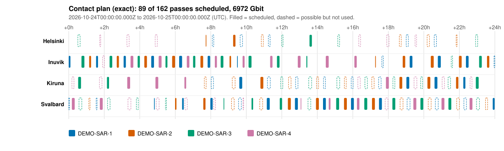

# leo-contact-planner

Predict **when a satellite flies over a ground station** (using the real orbit library
[Orekit](https://www.orekit.org)) and then decide **which of those fly-overs to actually use**, so the
satellites can send down as much data as possible. Written in Java.

```
$ mvn -q compile exec:java -Dexec.args="--tle data/demo_sats.tle --stations data/stations.csv --hours 24"
4 satellites x 4 stations -> 162 possible passes, 11709 Gbit if all could be used

[greedy]  85 of 162 passes, 6676.6 Gbit, 11.38 h of contact
[exact] (optimal)  89 of 162 passes, 6972.0 Gbit, 11.96 h of contact

exact vs greedy: +295.45 Gbit (+4.43%)
```



*The plan produced by the exact scheduler for 4 made-up radar satellites and 4 ground stations over
24 hours. Every bar is one fly-over; the colour says which satellite. **Filled** bars are used, **dashed**
outlines were possible but dropped because they clash with something more valuable. Hover a bar in
a browser to see its details.*

---

## Table of contents

1. [Why this project exists](#1-why-this-project-exists)
2. [The ideas, explained from zero](#2-the-ideas-explained-from-zero)
3. [Quick start](#3-quick-start)
4. [How it works, step by step](#4-how-it-works-step-by-step)
5. [Results and experiments](#5-results-and-experiments)
6. [Validation: how do we know the answers are right?](#6-validation-how-do-we-know-the-answers-are-right)
7. [Using your own satellites and stations](#7-using-your-own-satellites-and-stations)
8. [Project layout and tests](#8-project-layout-and-tests)
9. [Status and honest limits](#9-status-and-honest-limits)
10. [Roadmap](#10-roadmap)
11. [Questions you should be able to answer after this project](#11-questions-you-should-be-able-to-answer-after-this-project)
12. [References and licence](#12-references-and-licence)

---

## 1. Why this project exists

**The problem it models.** An Earth-observation satellite (for example a radar-imaging satellite like
those operated by Helsinki-area company ICEYE) takes pictures all around the planet, but the
pictures are only useful once they are **on the ground**. The satellite can send them down only while
it is in view of an antenna, and a low-orbit satellite is in view of any one antenna for just
**a few minutes per pass**, a handful of times per day. Meanwhile an antenna can talk to only one
satellite at a time, and a satellite can talk to only one antenna at a time. Somebody (or some
software) has to decide **which satellite uses which antenna when**. That is *contact planning*, one of
the core jobs of the "ground segment" of any satellite operator.

**What this repo is.** A small, open, from-scratch version of that planning step. It is **not**
ICEYE's (or anyone's) real planning system, whose details are not public; the satellites in this repo are
made up, and so are the data rates. It is a learning project that touches the same ideas:

* **orbit prediction** with a space-industry library (Orekit is an open-source
  flight-dynamics library, Apache-2.0 licensed, maintained by CS GROUP and a community of users),
* **event detection** (finding the exact instant a satellite crosses the horizon),
* **a scheduling / optimisation problem** with real structure (and a classic textbook algorithm
  that is *not* quite good enough, with the better one built next to it),
* **independent validation** against a second, unrelated implementation.

**Skills it trains:** Java 25 (records, interfaces, streams), Maven, the Orekit API, coordinate frames,
time scales (UTC and leap seconds), TLE/SGP4 orbit propagation, graph algorithms (maximum-weight
independent set, connected components, branch and bound), JUnit testing including property tests against a
brute-force referee, writing a CLI, generating SVG by hand.

**Where it fits with the sibling projects.** The data-rate staircase in section 2.5 is a simplified stand-in for
what [`ofdm-transceiver-cpp`](https://github.com/Entorkrasniqi/ofdm-transceiver-cpp) studies in detail
(stronger link -> denser modulation -> more bits per second). The telemetry-and-command side of a ground
segment is the subject of [`mini-mission-control`](https://github.com/Entorkrasniqi/mini-mission-control).

---

## 2. The ideas, explained from zero

You do not need to know any astronomy. Each idea below is used somewhere in the code.

### 2.1 An orbit, and why satellites keep coming back

A satellite in **low Earth orbit (LEO)** circles the planet roughly every 90-100 minutes at a height of a few
hundred kilometres. The demo satellites are at about **560 km** and take about **96 minutes** per lap, so
about **15 laps per day**. They use a **sun-synchronous orbit** (inclination 97.6 degrees, i.e. the orbit
passes nearly over the poles, tilted slightly backwards). The Earth turns underneath, so each lap passes over
a different strip of ground, and the satellite sees most of the planet over a day or two.

Polar orbits have a useful side effect: **places near the poles see the satellite on almost every lap**.
That is why satellite operators put ground stations in the Arctic (Svalbard, Kiruna, Inuvik are real
examples of such sites and are used here as illustrative locations).

### 2.2 TLE: the standard "orbit in two lines"

Instead of storing a full trajectory, the satellite world publishes an orbit as a **TLE (two-line element
set)**: two lines of 69 characters with the orbital elements (size, shape and tilt of the orbit, where the
satellite is on it) at one moment called the **epoch**.

```
DEMO-SAR-1
1 90001U          26297.00000000  .00000000  00000-0  10000-3 0    03
2 90001  97.6400  10.0000 0012000  90.0000   0.0000 15.02238327    04
```

Read it as: object number 90001, epoch = year 26, day 297.0 (that is 24 October 2026, 00:00 UTC), inclination
97.64 degrees, 15.02238327 laps per day. The last digit of each line is a **checksum** so typing mistakes
are noticed (this program checks it; see section 8).

To get the position at any other time you run a **propagator**. For TLEs the matching model is **SGP4**
(Simplified General Perturbations 4), which includes the main effects (Earth's bulge, atmospheric drag).
TLEs are only accurate for **days to about a week around their epoch**, because real orbits drift. Operators
refresh them constantly.

### 2.3 Frames and time (the two places beginners get bitten)

* **Frames.** SGP4 gives positions in an *inertial-like* frame (it does not rotate with the Earth; it is
  fixed relative to the stars). A ground station sits on the Earth, which rotates once every ~23 h 56 min.
  To ask "is the satellite above this antenna's horizon?" you must convert both into the same frame.
  Orekit does this; the ground station's frame is called **ITRF** (the Earth-fixed frame).
* **Time.** Humans use **UTC**, which sometimes inserts a **leap second**. Orbit maths needs a time
  scale without jumps. Converting needs a table of every leap second ever inserted. Orekit reads such tables from **data
  files**, which is why section 4.1 exists. A satellite moves about 7.5 km every second, so a clock error of
  just one second misplaces it by about 7.5 km; TAI (the leap-second-free scale) is 37 s ahead of UTC today, so
  mixing the two up would misplace the satellite by roughly 280 km. That is wrong enough to ruin a
  pass prediction, yet still looks like a plausible orbit position, which makes it a nasty bug.

### 2.4 Elevation, azimuth, AOS, LOS, pass

From an antenna's point of view the satellite's position is described by two angles:

```
              zenith (straight up)
                   |           * satellite
                   |        .
                   |    .  <- elevation: angle above the horizon (0 deg = on the horizon, 90 deg = overhead)
   horizon ________|_.______________
              antenna
   azimuth = compass direction: 0 = north, 90 = east, 180 = south, 270 = west
```

* **Elevation mask.** Trees, buildings and the thick air near the horizon make low signals useless, so each
  station has a minimum elevation (here 5-10 degrees). The satellite "counts" only above it.
* **AOS** (Acquisition Of Signal): the instant the satellite climbs above the mask. **LOS** (Loss Of Signal): the
  instant it drops below. **TCA** (Time of Closest Approach): the moment of highest elevation.
* A **pass** (also *contact* or *visibility window*) is the stretch from AOS to LOS. Typical length: 5-10
  minutes. The higher the satellite climbs, the longer and closer (stronger) the pass.

### 2.5 Data volume and the rate model

How much data a pass can carry = **rate x time**. The rate depends on elevation: low on the horizon the
signal crosses lots of atmosphere over a long distance and is weak; overhead it is strong, and a modem can
use a denser modulation to send more bits per second. This project reduces that to a **staircase**:

| elevation | downlink rate (placeholder!) |
|---|---|
| 0 - 10 degrees | 50 Mbit/s |
| 10 - 25 degrees | 150 Mbit/s |
| 25 degrees and up | 300 Mbit/s |

**These numbers are invented to make the optimisation interesting. They are not any real satellite's rate.**
The volume of a pass is the sum over each second of (rate at that moment) x (1 s).

### 2.6 Conflicts

Not every possible pass can be used:

1. **One antenna, one satellite at a time.** Two passes at the same station must not overlap, and the antenna needs a
   **guard time** (default 30 s) to swing around to the next satellite.
2. **One satellite, one antenna at a time.** A satellite cannot downlink to Svalbard and Kiruna simultaneously.
   (No guard time here: nothing has to re-point on the ground.)

Passes that clash like this are said to **conflict**.

### 2.7 Scheduling = picking the best conflict-free set

Draw each possible pass as a dot, and draw a line between every two dots that conflict. We want to select
dots **with no line between any two selected ones** and the **largest total volume**. In graph theory this is
the **maximum-weight independent set** problem. It is NP-hard in general (no known fast algorithm for all
inputs), but real contact plans have a lot of structure that makes it tractable (section 2.9).

### 2.8 Greedy: simple, fast, sometimes wrong

**Greedy** sorts the passes from most to least valuable and takes each one that does not clash with what it already took.

It fails like this. One long, valuable pass **A** (value 10) overlaps two shorter passes **B** and **C** (value 6 each)
that do not overlap each other:

```
time ->   0.........5.........10
pass A    [=====================]   value 10   <- greedy takes this first...
pass B    [==========]               value  6
pass C               [==========]    value  6   <- ...so B + C (value 12) can never be used
```

Greedy ends with 10; the best answer is 12. This exact case is the test
`greedyCanBeBeatenByTwoSmallerPasses`. And it is not only a textbook curiosity: in the 24-hour demo, greedy
loses by this mechanism in 4 places (section 5.2).

### 2.9 The exact scheduler: components + branch and bound

Two ideas make an **exactly optimal** answer cheap here:

1. **Components.** Passes only conflict if they overlap in time, so the conflict graph falls apart into
   small *islands* (connected components) that do not affect each other. In the demo, 162 passes form
   76 islands, the biggest with just 4 passes. Each island can be solved separately and the results added up.
2. **Branch and bound** inside an island. Pick a pass and try both worlds: "take it" (which removes everything
   that conflicts with it) and "skip it". Keep the best result seen so far; abandon a branch as soon
   as an *optimistic bound* (the current value plus the value of every pass still available) cannot
   beat it. Island sizes are tracked in 64-bit bitmasks so each step is a few machine instructions.

If an island has more than 60 passes (never in the demo), the exact scheduler falls back to greedy for that island
and honestly reports `exact = false`.

---

## 3. Quick start

You need **Java 25 or newer** and **Maven 3.9+** (`java -version`, `mvn -version`). Python 3 is needed only for the optional cross-check.

```bash
git clone https://github.com/Entorkrasniqi/leo-contact-planner.git
cd leo-contact-planner

mvn verify          # compiles, runs all 41 tests

# plan 24 hours for the bundled demo satellites and stations
mvn -q compile exec:java -Dexec.args="--tle data/demo_sats.tle --stations data/stations.csv --start 2026-10-24T00:00:00Z --hours 24 --out out"
```

You will find in `out/`:

| file | content |
|---|---|
| `passes.csv` | every possible pass: satellite, station, AOS, LOS, duration, max elevation, azimuths, volume, plus one `scheduled_<name>` column per scheduler |
| `schedule_greedy.csv`, `schedule_exact.csv` | just the chosen passes of each scheduler |
| `timeline_greedy.svg`, `timeline_exact.svg` | the pictures; open them in any browser |

Ready-made output of exactly this run is committed in [`docs/example/`](docs/example) so you can look at it
before installing anything.

### Command-line options

| option | meaning | default |
|---|---|---|
| `--tle FILE` | satellites (TLE file, 2- or 3-line format) | required |
| `--stations FILE` | CSV `name,lat_deg,lon_deg,alt_m,min_elevation_deg` | required |
| `--start TIME` | window start, ISO-8601 UTC, e.g. `2026-10-24T00:00:00Z` | epoch of the first TLE |
| `--hours N` | window length | 24 |
| `--scheduler` | `greedy`, `exact` or `both` | both |
| `--guard SECONDS` | antenna re-pointing gap at one station | 30 |
| `--min-el DEG` | override every station's elevation mask | per station |
| `--data SPEC` | `builtin` or a path to a full `orekit-data` folder (section 4.1) | builtin |
| `--out DIR` | output folder | `out` |

Exit codes: `0` success, `1` problem with input (the message says which file/line), `2` bad command line.

---

## 4. How it works, step by step

```
 demo_sats.tle ──► InputFiles ──► Satellite ─┐
 stations.csv  ──► InputFiles ──► GroundStation ─┤
                                              ▼
                     PassPredictor  (Orekit: SGP4 + elevation event detector)
                                              │  List<Pass>  (162 in the demo)
                                              ▼
              GreedyScheduler / ExactScheduler  (conflict rule + optimisation)
                                              │  Schedule
                                              ▼
                       Main: passes.csv, schedule_*.csv, TimelineSvg
```

### 4.1 `OrekitSetup` - telling Orekit about leap seconds

Orekit loads facts about time and the Earth from **data files**. Two modes:

* **`builtin`** (default): a small leap-second table (`UTC-TAI.history`, in IERS format) bundled in
  `src/main/resources/orekit-minimal/`. No network, no downloads. It has no *Earth orientation
  parameters* (EOP), tiny daily corrections worth up to a few hundred metres on the ground, which is
  far below a TLE's own error (kilometres), so it is the right default for pass prediction.
* **a directory**: a full checkout of Orekit's data repository
  (`git clone https://gitlab.orekit.org/orekit/orekit-data.git`) via `--data /path/to/orekit-data`.
  Use this if you want the last bit of accuracy or other models.

Orekit's data configuration is process-wide, so the first call wins.

The bundled table ends with the most recent leap second (added at the end of 2016, so TAI - UTC = 37 s since
1 January 2017); none had been announced through the end of 2026 when this was written. If the IERS ever adds
another one, update the file or use the full `orekit-data`.

One more simplification to be aware of: without EOP data, Orekit assumes UT1 = UTC (UT1 is the clock that
follows the Earth's actual rotation; it differs from UTC by up to 0.9 s). The Earth's surface moves up to
about 465 m/s at the equator, so this can shift a station by up to a few hundred metres in the model, and less at the high
latitudes used here. The cross-check script in section 6 makes the *same* assumption, so it cannot detect this particular
effect.

### 4.2 `GroundStation`, `Satellite`, `RateModel`, `Pass`

Small immutable Java **records** (a record is a class that is just its data; `equals`, `toString`
and accessors are generated).

* `GroundStation(name, latDeg, lonDeg, altM, minElevationDeg)` validates its values and builds an Orekit
  `TopocentricFrame` (origin at the antenna, axes east / north / up), the object that turns "satellite position"
  into "elevation and azimuth".
* `Satellite(name, tle)`.
* `RateModel` is the elevation staircase from section 2.5.
* `Pass` carries everything about one pass, including `clippedStart` / `clippedEnd`: true when the satellite was already (or
  still) in view at the edge of the planning window, so the pass is cut off there.

### 4.3 `PassPredictor` - finding the passes

1. Build a `TLEPropagator` (Orekit's SGP4/SDP4) for the satellite.
2. Attach an **`ElevationDetector`**, an *event detector*: while the propagator steps forward, the detector
   watches `elevation - mask`; when the sign changes it narrows the crossing time by root finding to
   **1 ms**. Rising crossing = AOS, falling = LOS. An `EventsLogger` collects them. The detector checks at least every
   20 s, which must be shorter than any pass worth planning.
3. If the satellite is already above the mask at the window start, the first pass is marked `clippedStart`.
4. Using a *second*, clean propagator, sample the elevation every second from AOS to LOS: the highest value is the max
   elevation, and `rate(elevation) x 1 s` summed over the pass is the **data volume**.

### 4.4 `Scheduler.conflict` - the rule everything rests on

```java
sameStation   -> guard time applies
sameSatellite -> plain overlap
otherwise     -> never conflict
conflict  <=>  a.aos - b.los < guard   AND   b.aos - a.los < guard
```

Two intervals (each padded by the guard) overlap exactly when each starts before the other ends.
Touching exactly at the guard distance is allowed. Tests cover all those edge cases.

### 4.5 `GreedyScheduler` and `ExactScheduler`

Both implement the same tiny `Scheduler` interface (`name()` and `schedule(passes, guard)`), so you can
add a third algorithm without touching anything else. `Greedy` is short (about 20 lines). `Exact` builds the conflict
matrix, finds connected components with a breadth-first search, and solves each component with the bitmask branch and
bound from section 2.9. The branching vertex is the one with the most remaining conflicts (it prunes the most
either way), and a vertex with no conflicts is just taken.

### 4.6 `TimelineSvg` and `Main`

SVG is plain text: one `<rect>` per pass, positioned by time. Colours come from the Okabe-Ito
palette, designed to be readable with common colour-vision deficiencies. Each bar has a `<title>`,
which browsers show as a tooltip. `Main` parses options, runs the pipeline and writes the files.

---

## 5. Results and experiments

All numbers below come from running this repo (Java 21, Orekit 13.1.9) on the bundled demo data;
rerun the commands to reproduce them.

### 5.1 The 24-hour demo

| | greedy | exact |
|---|---:|---:|
| passes used (of 162 possible) | 85 | 89 |
| data volume | 6,676.6 Gbit | 6,972.0 Gbit |
| contact time | 11.38 h | 11.96 h |

Exact beats greedy by **+295.5 Gbit (+4.4 %)**. Even the best plan uses only **59.5 %** of the 11,709 Gbit that
is theoretically on offer: the rest is lost to conflicts. Over 72 hours the picture is the same
(478 possible passes, greedy 19,993 Gbit, exact 20,857 Gbit, +4.3 %).

Antenna busy time (share of the 24 h window) under the exact plan: Inuvik 22.1 %, Svalbard 17.2 %, Kiruna
9.3 %, Helsinki 1.2 %. No antenna is anywhere near saturated; the conflicts that matter are the next kind.

### 5.2 Where greedy loses, concretely

The exact plan beats greedy in exactly **4 islands** out of 76, and it is the same situation each time (here
for DEMO-SAR-2 around 18:37-18:57 UTC; volumes in Mbit):

| satellite over | AOS - LOS (UTC) | volume | greedy | exact |
|---|---|---:|:-:|:-:|
| Helsinki | 18:37:07 - 18:43:40 | 58,772 | | |
| Kiruna | 18:37:35 - 18:47:00 | 104,023 | | X |
| Svalbard | 18:39:43 - 18:49:36 | 118,740 | X | |
| Inuvik | 18:48:38 - 18:57:07 | 62,051 | | X |

The satellite flies over the Arctic, so it can see Helsinki, Kiruna and Svalbard almost together, and a
few minutes later Inuvik, on the other side of the pole. Since it can use only one antenna at a time, greedy
takes the single most valuable pass (Svalbard, 118.7 Gbit) and thereby blocks Inuvik. The optimal plan
uses **Kiruna and then Inuvik (166.1 Gbit)**. That is +47.3 Gbit from re-thinking one orbit.

### 5.3 Experiment: how much does the guard time matter?

(24 h, otherwise default.)

| guard | greedy passes / volume | exact passes / volume |
|---:|---|---|
| 0 s | 85 / 6,676.6 Gbit | 89 / 6,972.0 Gbit |
| 30 s (default) | 85 / 6,676.6 Gbit | 89 / 6,972.0 Gbit |
| 120 s | 85 / 6,676.6 Gbit | 89 / 6,972.0 Gbit |
| 300 s | 85 / 6,676.6 Gbit | 89 / 6,972.0 Gbit |
| 600 s | 83 / 6,652.4 Gbit | 87 / 6,947.9 Gbit |

With only 4 satellites, a realistic re-pointing time almost never changes the plan; a 10-minute guard
costs 2 passes. With more satellites per antenna it would matter much more (roadmap L8).

### 5.4 Experiment: the elevation mask is the big lever

`--min-el` overrides the mask of all four stations.

| mask | possible passes | exact: passes / volume | exact vs greedy |
|---:|---:|---|---:|
| 0 degrees | 196 | 86 / 7,442.6 Gbit | +3.6 % |
| 5 degrees | 170 | 88 / 6,979.8 Gbit | +4.4 % |
| 10 degrees | 142 | 84 / 6,639.5 Gbit | 0.0 % |
| 20 degrees | 92 | 65 / 4,482.7 Gbit | +3.4 % |
| 30 degrees | 71 | 56 / 3,102.4 Gbit | +3.1 % |

A demanding antenna (30 degrees) throws away more than half the volume of a permissive one (5 degrees).
Notice also that at 10 degrees greedy happens to be optimal: greedy is not *always* worse, which is
why you measure instead of assuming.

### 5.5 Experiment: constellation size

Using only DEMO-SAR-1 and DEMO-SAR-2: 82 possible passes, exact plan 3,528.7 Gbit. All four: 162 passes,
6,972.0 Gbit, i.e. **1.98x** the volume for 2x the satellites. Scaling is nearly linear because the antennas
are far from full (section 5.1); it would flatten once antennas became the bottleneck.

---

## 6. Validation: how do we know the answers are right?

A passing test only shows the code does what the author *thought* it should. Three layers of evidence:

1. **An independent oracle** - `tools/crosscheck.py` recomputes the physics with entirely different code
   (the `sgp4` Python package for propagation plus ~30 lines of NumPy for Earth rotation and elevation) and compares:
   * *pass counts* for all 16 satellite/station pairs over 24 h: **identical** (e.g. 15 for DEMO-SAR-1 at Svalbard, 10 at Kiruna);
   * *timing* of every AOS and LOS (321 event times): mean difference **0.3 ms**, maximum **3.7 ms**.
   The two programs share no code, so a bug would have to appear in both at once.
   (This agreement shows the implementation is consistent. It does **not** say the *TLE* matches reality: a real TLE is
   itself wrong by kilometres, i.e. seconds of timing, after a few days.)
2. **Unit tests** (41) including *oracle-derived constants* (DEMO-SAR-1 over Kiruna: AOS 08:01:46.643, LOS 08:09:12.243, peak 14.42 degrees),
   the clipping cases, the exact scheduler compared with **brute force on 300 random instances**, and the guarantee that greedy is never
   better than exact. (The two comparisons against brute force and against the oracle are the strongest ones.)
3. **Mutation check** (done by hand once while building this, not part of the repo): five deliberate bugs were put into the code one at a
   time (guard comparison `<` -> `<=`, dropping the "skip it" branch, elevation mask in degrees instead of radians, the last partial
   second of a pass counted as a full second, ignoring the same-satellite rule). Each one made at least one test fail. A test suite that cannot fail is worthless; this showed
   it can. The same exercise caught a real bug during development: Orekit's `TLE` constructor does **not** verify the checksum digit,
   so a typo in a TLE would have silently produced a different orbit. The reader now calls `TLE.isFormatOK` explicitly.

To reproduce the cross-check:

```bash
mvn -q compile exec:java -Dexec.args="--tle data/demo_sats.tle --stations data/stations.csv --start 2026-10-24T00:00:00Z --hours 24 --out out"
python3 -m pip install sgp4 numpy
python3 tools/crosscheck.py --tle data/demo_sats.tle --stations data/stations.csv \
        --passes out/passes.csv --start 2026-10-24T00:00:00Z --hours 24
```

---

## 7. Using your own satellites and stations

**TLEs.** Any file in the usual 3-line (name + 2 lines) or plain 2-line format works; `#` comment lines and
blank lines are ignored. Public TLEs of many satellites are published by sites such as
[CelesTrak](https://celestrak.org). **Always set `--start` close to the TLE's epoch** (within a few days),
otherwise the prediction is stale. The bundled `data/demo_sats.tle` was generated for this repo: four **synthetic**
sun-synchronous satellites at 560 km with made-up names (`DEMO-SAR-1..4`) and catalogue numbers; they are **not ICEYE's
satellites or orbits**, and their epoch is 24 October 2026.

**Stations.** `data/stations.csv` is a comma-separated list. The bundled coordinates are *approximate and illustrative*: edit
them, add your own city, change the elevation mask.

```
# name,lat_deg,lon_deg,alt_m,min_elevation_deg
Helsinki,60.17,24.94,20,10
```

**Rates.** The elevation->rate staircase lives in `RateModel.illustrativeDefault()`. Replace it with numbers from a real link budget
(roadmap L3).

---

## 8. Project layout and tests

```
leo-contact-planner/
├── pom.xml                     Maven build (Orekit 13.1.9, JUnit 5)
├── data/                       demo_sats.tle, stations.csv
├── docs/                       timeline.svg and example/ (committed output of the 24 h demo)
├── tools/crosscheck.py         the independent sgp4 oracle (section 6)
├── .github/workflows/ci.yml    build + tests + demo run + cross-check on GitHub Actions
├── src/main/java/io/github/entorkrasniqi/contacts/
│   ├── OrekitSetup.java        leap-second data, frames, Earth model
│   ├── GroundStation.java  Satellite.java  RateModel.java  Pass.java
│   ├── PassPredictor.java      TLE -> passes (Orekit event detection)
│   ├── InputFiles.java         TLE and station file readers (with checksum + line-number errors)
│   ├── Scheduler.java          interface + the conflict rule
│   ├── GreedyScheduler.java  ExactScheduler.java  Schedule.java
│   ├── TimelineSvg.java  Times.java  Main.java
├── src/main/resources/orekit-minimal/UTC-TAI.history   bundled leap seconds
└── src/test/java/.../          41 tests (below)
```

| test class | tests | what it protects |
|---|---:|---|
| `PassPredictorTest` | 10 | oracle times, clipping at window edges, mask handling, volume = rate x time, ordering |
| `SchedulerTest` | 11 | every conflict-rule edge case, the greedy trap, **brute-force comparison**, fallback, speed on 500 passes |
| `InputFilesTest` | 8 | TLE/CSV parsing, comments, checksum error, line numbers in messages, range checks |
| `MainTest` | 6 | end-to-end files, the documented demo numbers, exit codes |
| `RateModelTest` | 4 | tier boundaries and validation |
| `TimelineSvgTest` | 2 | the SVG is well-formed XML, dashed vs filled bars, escaping |

---

## 9. Status and honest limits

**Done and checked when this repo was created:**

* All main and test code compiles without warnings (`javac -Xlint:all --release 25`) against Orekit 13.1.9 and Hipparchus 4.0.3.
* All 41 tests pass, and the five hand-made mutations were each caught (section 6).
* The independent Python cross-check passes (pass counts identical, timing within 3.7 ms).

**Not verified yet - do these first:**

* **`mvn verify` has not been run.** The environment this repo was written in could not download from Maven Central. The code was compiled
  with `javac` directly against the Orekit/Hipparchus jars and the tests were run with a minimal stand-in for the JUnit annotations
  and assertions. The `pom.xml` parses (`mvn validate` passes) but its dependency resolution and the Surefire/JUnit run are untested. If something
  fails, check plugin and dependency versions first.
* **GitHub Actions CI** (`.github/workflows/ci.yml`) has not run yet.
* **A real `orekit-data` directory** (`--data /path`) was not available; only the bundled leap-second file and a directory containing just that file were tried.
* **Real TLEs** (e.g. from CelesTrak) were not fetched; only the synthetic demo satellites were used.

**Limits of the model (say these out loud if you present the project):**

* **The satellites, data rates and station coordinates are illustrative.** The results demonstrate the method, not any operator's real numbers.
* The rate is a function of elevation only: no weather, no real link budget, no modulation switching, no antenna slew limits.
* Passes have a fixed value (volume). There is **no onboard storage model**: a real planner must know what data the satellite
  actually has to send and when it was collected, and avoid buffer overflow.
* No imaging (tasking) side: only the downlink.
* TLE/SGP4 accuracy is kilometres; fine for planning demos, not for pointing an antenna.
* UT1 is assumed equal to UTC (no EOP data in the default mode), see section 4.1.
* The exact scheduler is exact only while every island has at most 60 passes (it says so when it falls back).

---

## 10. Roadmap

| # | Milestone | You will learn | Done when |
|---|---|---|---|
| L1 | **Real TLEs**: fetch current TLEs of public satellites and compare predicted AOS/LOS with a public pass-prediction website | data reality, TLE ageing | 5 passes agree within a few seconds; table in README |
| L2 | **Full `orekit-data`**: run with EOP data and quantify the difference to `builtin` | what the data files do | mean difference reported in ms |
| L3 | **Real rate model**: compute the rate per second from slant range (free-space loss, atmosphere) and a modulation table | link budgets (ties to `ofdm-transceiver-cpp`) | `RateModel` replaced by a function of distance; README plots volume vs max elevation |
| L4 | **Onboard storage**: satellites generate data over time; schedule to keep the buffer from overflowing | time-expanded models | a plan that provably never overflows a 1 Tbit buffer |
| L5 | **Imaging access**: when can the satellite look at a target area (look-angle limits)? | tasking, geometry | a list of imaging opportunities for a target city |
| L6 | **Integer programming**: formulate scheduling as a 0-1 program and solve with a library; compare with branch and bound | optimisation toolboxes | runtime and optimality table |
| L7 | **Operational constraints**: minimum useful pass length, antenna slew rate, maintenance windows, per-station cost | real-world constraints | each constraint has a test |
| L8 | **Scale**: 40 satellites, 10 stations; profile; report island-size distribution | performance engineering | benchmark in README; fallback threshold justified |
| L9 | **Visualise**: export ground tracks as CZML and view in Cesium | data formats | screenshot in README |

---

## 11. Questions you should be able to answer after this project

1. What is a TLE and why does its accuracy fade after a few days?
2. Why do we need a leap-second table to predict a pass? What would go wrong without it?
3. What is the difference between AOS, LOS and TCA? What is an elevation mask for?
4. How does an event detector find the AOS time to the millisecond without computing positions every millisecond?
5. Why do polar ground stations see satellites in polar orbits so often?
6. State the scheduling problem as a graph problem. What are the vertices, edges and weights?
7. Give a small example where greedy is not optimal. Why can greedy never recover?
8. Why does splitting into connected components make an NP-hard problem easy here? What would break that?
9. What does the "bound" in branch and bound do, and why is it safe to prune with it?
10. Why is agreement with an independent program (the sgp4 oracle) better evidence than a unit test you wrote yourself, and what does it *not* prove?
11. Which model assumption would you replace first with real data, and how?

---

## 12. References and licence

* Orekit - open-source space flight dynamics library: <https://www.orekit.org> (documentation, tutorials; data repository at <https://gitlab.orekit.org/orekit/orekit-data>).
* F. R. Hoots and R. L. Roehrich, *Spacetrack Report No. 3: Models for Propagation of NORAD Element Sets* (1980), the original SGP4 description.
* D. Vallado, P. Crawford, R. Hujsak and T. S. Kelso, *Revisiting Spacetrack Report #3*, AIAA 2006-6753.
* D. Vallado, *Fundamentals of Astrodynamics and Applications* - frames, time scales, SGP4.
* CelesTrak (T. S. Kelso): <https://celestrak.org> - public TLE data and an explanation of the TLE format.
* J. Kleinberg and E. Tardos, *Algorithm Design* - interval scheduling (the easy single-resource case) and independent set.
* A. H. Land and A. G. Doig, "An automatic method of solving discrete programming problems", *Econometrica* 1960 - branch and bound.
* M. Okabe and K. Ito, *Color Universal Design* (the colour-blind-safe palette used in the figures).
* The Python [`sgp4`](https://pypi.org/project/sgp4/) package used by the cross-check.

MIT licence for this repository's code - see [`LICENSE`](LICENSE). Orekit is Apache-2.0; the Hipparchus maths library it uses is also Apache-2.0.
# leo-contact-planner-
